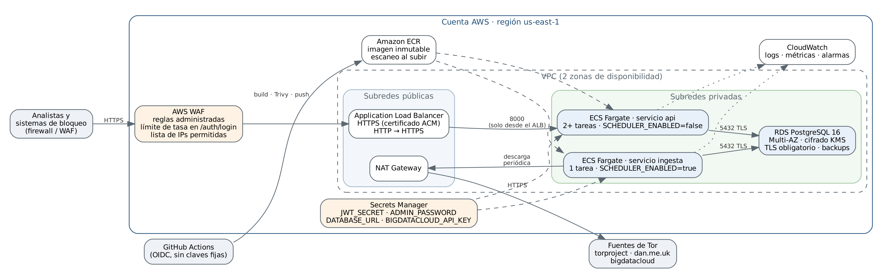

# Despliegue en la nube (AWS)

Este documento explica cómo ejecutaría Tor IP API en AWS. Es una propuesta de diseño: la solución no está desplegada en la nube (ese punto es un extra del reto y no se implementó).

## 1. Objetivo y criterios

El objetivo es ejecutar la misma imagen que hoy corre con Docker Compose, sin cambiar el código, en una infraestructura administrada, disponible y segura. Las decisiones de este documento siguen cinco criterios:

- **Sin cambios en el código.** Todo lo que cambia entre local y la nube se resuelve con variables de entorno que la aplicación ya soporta.
- **Servicios administrados.** Ni servidores ni bases de datos que parchear a mano: AWS se encarga del sistema operativo, las réplicas y los respaldos.
- **Nada expuesto que no deba estarlo.** Solo el balanceador recibe tráfico de internet; la API y la base viven en subredes privadas.
- **Mínimo privilegio.** Cada componente (la tarea, el pipeline, la base) tiene solo los permisos que necesita.
- **Todo queda registrado.** Las peticiones, los cambios de infraestructura y los accesos a secretos dejan rastro.

Se eligió AWS porque cubre con servicios administrados todo lo que la aplicación ya usa (contenedor, PostgreSQL, secretos y logs). Al final hay una tabla con los equivalentes en GCP y Azure, donde el diseño es el mismo.

## 2. Arquitectura



| Necesidad | En Docker Compose | En AWS |
|---|---|---|
| Imagen de la API | Se construye localmente | **Amazon ECR**, con escaneo al subir y etiquetas inmutables |
| Ejecución del contenedor | Servicio `api` | **ECS sobre Fargate** (contenedores sin administrar servidores) |
| Base de datos | Contenedor `postgres:16-alpine` | **RDS for PostgreSQL 16**, Multi-AZ, cifrada con KMS |
| Secretos | Archivo `.env` | **AWS Secrets Manager**, inyectados en la tarea al arrancar |
| Entrada HTTP | Puerto 8000 publicado | **Application Load Balancer** con HTTPS (certificado de ACM) |
| Protección perimetral | — | **AWS WAF** delante del balanceador |
| Logs y auditoría | Salida del contenedor y tabla `audit_log` | **CloudWatch Logs** y la misma tabla `audit_log` en RDS |
| Salida a internet | Red de Docker | **NAT Gateway** desde las subredes privadas |
| Registro de cambios | — | **CloudTrail** y **GuardDuty** |

Recorrido de una petición: el cliente llega por HTTPS al balanceador; WAF la filtra; el balanceador la reenvía a una tarea del servicio `api` en una subred privada; la API valida el token y el rol, consulta RDS y responde. En paralelo, la tarea del servicio `ingesta` descarga las fuentes por el NAT Gateway y actualiza RDS.

## 3. Red

### Plan de direcciones

Una VPC `10.0.0.0/16` en dos zonas de disponibilidad, con tres niveles de subred:

| Nivel | Zona A | Zona B | Qué contiene | Ruta a internet |
|---|---|---|---|---|
| Pública | `10.0.0.0/24` | `10.0.1.0/24` | Balanceador y NAT Gateway | Internet Gateway |
| Privada de aplicación | `10.0.10.0/24` | `10.0.11.0/24` | Tareas de ECS | Solo salida, por el NAT Gateway |
| Privada de datos | `10.0.20.0/24` | `10.0.21.0/24` | RDS | Ninguna |

Las subredes de datos no tienen ruta a internet en ningún sentido: aunque alguien lograra ejecutar código en la base, no podría sacar datos directamente.

### Grupos de seguridad

Cada grupo solo acepta tráfico del grupo anterior, no de rangos de IP:

| Grupo | Entrada permitida | Origen | Salida permitida |
|---|---|---|---|
| `sg-alb` | 443 y 80 (80 solo redirige a 443) | Internet, filtrado por WAF | 8000 hacia `sg-api` |
| `sg-api` | 8000 | Solo `sg-alb` | 5432 hacia `sg-rds`; 443 hacia internet (fuentes y servicios de AWS) |
| `sg-rds` | 5432 | Solo `sg-api` | Ninguna |

El servicio `ingesta` usa `sg-api` sin estar detrás del balanceador, así que en la práctica no recibe ninguna conexión entrante.

### Endpoints de VPC

Para que el tráfico hacia los servicios de AWS no pase por internet (ni por el NAT Gateway, que cobra por GB), se crean endpoints privados para ECR (`ecr.api` y `ecr.dkr`), S3 (de tipo gateway, donde ECR guarda las capas de la imagen), Secrets Manager y CloudWatch Logs. Así, por el NAT Gateway solo sale la descarga de las tres fuentes de Tor.

## 4. Cómputo: ECS Fargate

### Dos servicios con la misma imagen

La aplicación ejecuta el planificador de ingesta dentro del mismo proceso que la API, y su bloqueo de ingesta vive en memoria. Si se escalara a varias tareas sin más, cada una descargaría las fuentes por su cuenta y `dan.me.uk` podría bloquear la IP de salida. Por eso se usan **dos servicios de ECS con la misma imagen**, que solo se distinguen por una variable de entorno que la aplicación ya soporta:

| Servicio | Tareas | `SCHEDULER_ENABLED` | Detrás del balanceador | Función |
|---|---|---|---|---|
| `api` | Mínimo 2, máximo 4 | `false` | Sí | Atiende las peticiones |
| `ingesta` | Exactamente 1 | `true` | No | Descarga las fuentes y actualiza la base |

- **Despliegue del servicio `ingesta`:** con `minimumHealthyPercent = 0` y `maximumPercent = 100`, ECS detiene la tarea vieja antes de arrancar la nueva. Nunca hay dos planificadores a la vez, ni siquiera durante un despliegue.
- **Despliegue del servicio `api`:** con `minimumHealthyPercent = 100` y `maximumPercent = 200`, ECS levanta las tareas nuevas antes de detener las viejas, sin cortar el servicio.
- **Refresh manual:** `POST /sources/refresh` se atiende en una tarea del servicio `api` y podría coincidir con un ciclo del servicio `ingesta`. El intervalo mínimo por fuente que la aplicación guarda en la base evita que `dan.me.uk` se consulte dos veces en 30 minutos; como mejora, el bloqueo de ingesta podría pasar a un *advisory lock* de PostgreSQL para que sea único entre todas las tareas.

### Definición de la tarea

Cada tarea usa 0.5 vCPU y 1 GB de memoria, suficiente para el volumen de esta API. Los puntos de seguridad de la definición:

- **Usuario sin privilegios:** la imagen ya corre como `appuser` (uid 10001); la definición lo repite con `user`.
- **Sistema de archivos de solo lectura** (`readonlyRootFilesystem`), con un volumen efímero montado en `/tmp` por si alguna librería necesita archivos temporales.
- **Sin variables con secretos:** los secretos llegan por el bloque `secrets`, que ECS resuelve en Secrets Manager al arrancar la tarea.
- **Verificación de salud:** el mismo comando del `HEALTHCHECK` del Dockerfile.
- **Logs** a CloudWatch con el controlador `awslogs`.

Extracto de la definición del contenedor del servicio `api` (el de `ingesta` solo cambia `SCHEDULER_ENABLED`):

```json
{
  "name": "api",
  "image": "<cuenta>.dkr.ecr.us-east-1.amazonaws.com/tor-ip-api:<commit>",
  "essential": true,
  "user": "10001",
  "readonlyRootFilesystem": true,
  "portMappings": [{ "containerPort": 8000, "protocol": "tcp" }],
  "environment": [
    { "name": "SCHEDULER_ENABLED", "value": "false" },
    { "name": "FORWARDED_ALLOW_IPS", "value": "10.0.0.0/16" }
  ],
  "secrets": [
    { "name": "JWT_SECRET", "valueFrom": "<arn>:tor-ip-api/jwt-secret" },
    { "name": "ADMIN_PASSWORD", "valueFrom": "<arn>:tor-ip-api/admin-password" },
    { "name": "DATABASE_URL", "valueFrom": "<arn>:tor-ip-api/database-url" },
    { "name": "BIGDATACLOUD_API_KEY", "valueFrom": "<arn>:tor-ip-api/bdc-key" }
  ],
  "mountPoints": [{ "sourceVolume": "tmp", "containerPath": "/tmp" }],
  "logConfiguration": {
    "logDriver": "awslogs",
    "options": {
      "awslogs-group": "/ecs/tor-ip-api",
      "awslogs-region": "us-east-1",
      "awslogs-stream-prefix": "api"
    }
  }
}
```

### Variables de entorno

| Variable | Servicio `api` | Servicio `ingesta` | Origen |
|---|---|---|---|
| `SCHEDULER_ENABLED` | `false` | `true` | Definición de la tarea |
| `FORWARDED_ALLOW_IPS` | `10.0.0.0/16` | — | Definición de la tarea |
| `JWT_SECRET`, `ADMIN_PASSWORD` | Sí | Sí | Secrets Manager |
| `DATABASE_URL` | Sí | Sí | Secrets Manager |
| `BIGDATACLOUD_API_KEY` | — | Sí | Secrets Manager |
| `*_INTERVAL_MIN`, `JWT_EXPIRE_MIN`, `LOGIN_*` | Valores por defecto | Valores por defecto | Definición de la tarea, si se quieren cambiar |

El servicio `api` también necesita `BIGDATACLOUD_API_KEY` si se usa `POST /sources/refresh`, porque el refresh manual se ejecuta en esa tarea.

## 5. Base de datos: RDS for PostgreSQL

- **Motor y tamaño:** PostgreSQL 16 en una instancia pequeña de la familia `db.t4g`, con almacenamiento `gp3` de 20 GB y crecimiento automático. El volumen de datos de esta API es de unos miles de filas.
- **Alta disponibilidad:** Multi-AZ. Si falla la zona principal, RDS promueve la réplica de la otra zona y el nombre DNS de la base no cambia, así que la aplicación se reconecta sola.
- **Cifrado:** en reposo con una clave de KMS administrada por el cliente; en tránsito con `rds.force_ssl = 1` y `sslmode=require` en la URL de conexión.
- **Respaldos:** automáticos con 7 días de retención y recuperación a un punto en el tiempo; protección contra borrado activada; *snapshot* final al eliminar la instancia.
- **Usuarios:** el usuario maestro lo administra RDS en Secrets Manager y no lo usa la aplicación. La aplicación se conecta con un usuario propio, dueño solo de su esquema.
- **Tablas:** se crean igual que en local, al arrancar la aplicación. Para cambios de esquema en producción se usaría Alembic (ver «Cambios recomendados en el código para producción»).

## 6. Identidad y permisos (IAM)

| Rol | Lo usa | Permisos |
|---|---|---|
| Rol de ejecución de la tarea | ECS, al arrancar la tarea | Descargar la imagen de este repositorio de ECR, escribir en su grupo de logs y leer **solo** los cuatro secretos de la aplicación (`secretsmanager:GetSecretValue` y `kms:Decrypt` sobre esas claves) |
| Rol de la tarea | La aplicación en ejecución | Ninguno: la aplicación no llama a servicios de AWS |
| Rol de despliegue | GitHub Actions, por OIDC | Subir imágenes a este repositorio de ECR, registrar definiciones de tarea, actualizar los dos servicios y `iam:PassRole` solo sobre el rol de ejecución |

El rol de despliegue solo lo puede asumir el pipeline de la rama `main` de este repositorio. La condición de confianza lo fija:

```json
"Condition": {
  "StringEquals": {
    "token.actions.githubusercontent.com:aud": "sts.amazonaws.com",
    "token.actions.githubusercontent.com:sub":
      "repo:AnaLauraRG/tor-ip-api:ref:refs/heads/main"
  }
}
```

Así, ni un *fork* ni otra rama ni otro repositorio pueden desplegar, y no hay claves de acceso de AWS guardadas en GitHub.

## 7. Secretos

| Secreto | Variable | Cómo se genera | Rotación |
|---|---|---|---|
| `tor-ip-api/jwt-secret` | `JWT_SECRET` | `openssl rand -base64 48` | Manual. Rotarlo invalida todos los tokens vigentes: es la forma de cerrar todas las sesiones si se sospecha una filtración |
| `tor-ip-api/admin-password` | `ADMIN_PASSWORD` | Generada, 12 caracteres o más | Solo se usa en el primer arranque; después la contraseña se cambia en la aplicación |
| `tor-ip-api/database-url` | `DATABASE_URL` | Construida con el usuario de la aplicación | Manual, junto con la contraseña del usuario de la base |
| `tor-ip-api/bdc-key` | `BIGDATACLOUD_API_KEY` | Panel de bigdatacloud | Según la política del proveedor |

Las tareas leen los secretos al arrancar. Después de rotar uno, se fuerza un nuevo despliegue (`aws ecs update-service --force-new-deployment`) para que las tareas lo tomen. Cada lectura de un secreto queda registrada en CloudTrail.

## 8. Entrada: balanceador, HTTPS y WAF

### Application Load Balancer

- **HTTPS** en el puerto 443 con un certificado de **ACM** y la política TLS `ELBSecurityPolicy-TLS13-1-2-2021-06` (solo TLS 1.2 y 1.3).
- El puerto 80 solo responde con una redirección a HTTPS.
- **Verificación de salud** del grupo de destino en `GET /health`, que solo responde 503 si la base de datos no está disponible.
- Descarta cabeceras HTTP mal formadas (`drop_invalid_header_fields`).
- Guarda sus logs de acceso en un bucket de S3 cifrado.

### IP real del cliente

Detrás del balanceador, la aplicación vería la IP del balanceador en la auditoría y en el límite de login. Uvicorn ya lee la cabecera `X-Forwarded-For`; basta con indicarle que solo confíe en direcciones de la VPC, sin cambiar el código:

```
FORWARDED_ALLOW_IPS=10.0.0.0/16
```

Así toma como origen la última IP que agrega el balanceador, y un cliente no puede falsificar su IP enviando su propia cabecera `X-Forwarded-For`.

### AWS WAF

Las reglas se evalúan en este orden:

| Prioridad | Regla | Acción | Para qué |
|---|---|---|---|
| 1 | Lista de IPs permitidas (red corporativa y sistemas consumidores) | Bloquear todo lo que no esté en la lista | Es una herramienta interna del equipo de seguridad |
| 2 | `AWSManagedRulesAmazonIpReputationList` | Bloquear | IPs conocidas por actividad maliciosa |
| 3 | `AWSManagedRulesCommonRuleSet` | Bloquear | Ataques web comunes |
| 4 | `AWSManagedRulesKnownBadInputsRuleSet` | Bloquear | Entradas maliciosas conocidas |
| 5 | Límite de tasa en `/auth/login` (por ejemplo, 20 peticiones por IP cada 5 minutos) | Bloquear | Fuerza bruta contra el login |

La regla 5 reemplaza al límite de intentos de la aplicación, que vive en memoria y con varias tareas se contaría por separado en cada una. El límite de la aplicación se mantiene como segunda capa.

## 9. Observabilidad y alertas

- **Logs:** CloudWatch Logs, grupo `/ecs/tor-ip-api`, con 90 días de retención. Cada petición aparece ahí además de en la tabla `audit_log`.
- **Métricas:** Container Insights para CPU y memoria de las tareas; métricas propias de RDS y del balanceador.
- **Filtros de métricas y alarmas**, que notifican por SNS (correo o el canal del equipo):

| Alarma | Condición | Qué puede indicar |
|---|---|---|
| Fuerza bruta | Más de 20 respuestas 401 en 5 minutos | Prueba de contraseñas o tokens robados |
| Acceso indebido | Más de 10 respuestas 403 en 5 minutos | Un usuario `reader` intentando operaciones de admin |
| Login bloqueado | Cualquier respuesta 429 | Alguien superó el límite de intentos |
| Errores del servidor | 5xx del balanceador por encima del 1 % | Falla de la aplicación o de la base |
| Fuente caída | Una fuente con error en `/health` durante más de 2 ciclos | Cambio de formato o bloqueo de la fuente |
| Servicio degradado | Tareas del servicio `api` por debajo de 2 | Fallas al arrancar o en la verificación de salud |
| Base de datos | CPU de RDS por encima del 80 % o almacenamiento libre bajo | Consultas costosas o crecimiento de `audit_log` |

- **CloudTrail** registra cada cambio en la infraestructura y cada lectura de secretos.
- **GuardDuty**, con el monitoreo en tiempo de ejecución para ECS, detecta comportamiento anómalo dentro de las tareas (por ejemplo, conexiones a destinos maliciosos).

## 10. Integración y despliegue continuo

El pipeline de GitHub Actions que ya existe (pruebas, Bandit, Semgrep, pip-audit, Trivy y Gitleaks) se amplía con un trabajo de despliegue que corre solo en la rama `main` y solo si todo lo anterior pasa:

1. Se autentica en AWS con **OIDC** y asume el rol de despliegue descrito en «Identidad y permisos».
2. Construye la imagen, la escanea otra vez con Trivy y la sube a ECR con el hash del commit como etiqueta. Como las etiquetas son inmutables, una versión publicada no se puede reemplazar.
3. Registra una nueva revisión de la definición de tarea con esa imagen.
4. Actualiza los servicios `api` e `ingesta` y espera a que se estabilicen.
5. Si las tareas nuevas no pasan la verificación de salud, el *circuit breaker* de ECS vuelve a la revisión anterior.

Extracto del trabajo de despliegue:

```yaml
deploy:
  needs: [tests, security]
  if: github.ref == 'refs/heads/main'
  runs-on: ubuntu-latest
  permissions:
    id-token: write
    contents: read
  steps:
    - uses: actions/checkout@v4
    - uses: aws-actions/configure-aws-credentials@v4
      with:
        role-to-assume: ${{ vars.AWS_DEPLOY_ROLE_ARN }}
        aws-region: us-east-1
    - id: ecr
      uses: aws-actions/amazon-ecr-login@v2
    - run: |
        IMAGE=${{ steps.ecr.outputs.registry }}/tor-ip-api:${{ github.sha }}
        docker build -t "$IMAGE" .
        docker push "$IMAGE"
        echo "IMAGE=$IMAGE" >> "$GITHUB_ENV"
    - id: task
      uses: aws-actions/amazon-ecs-render-task-definition@v1
      with:
        task-definition: infra/task-api.json
        container-name: api
        image: ${{ env.IMAGE }}
    - uses: aws-actions/amazon-ecs-deploy-task-definition@v2
      with:
        task-definition: ${{ steps.task.outputs.task-definition }}
        cluster: tor-ip-api
        service: api
        wait-for-service-stability: true
```

El servicio `ingesta` se actualiza con un paso igual que usa su propia definición de tarea. La infraestructura (VPC, grupos de seguridad, RDS, roles, WAF) se describe como código con Terraform o AWS CDK, para que cada cambio se revise en un pull request igual que el código.

## 11. Escalado, disponibilidad y recuperación

| Situación | Qué pasa | Efecto en el servicio |
|---|---|---|
| Una tarea `api` falla | ECS la reemplaza; el balanceador deja de enviarle tráfico | Ninguno: la otra tarea sigue atendiendo |
| Sube la carga | Escalado automático por CPU (objetivo 60 %), de 2 a 4 tareas | Ninguno |
| Cae una zona de disponibilidad | Las tareas siguen en la otra zona; RDS cambia a su réplica | Interrupción de la base del orden de uno a dos minutos |
| Falla la tarea `ingesta` | ECS la reemplaza; la API sigue sirviendo los datos guardados | Las listas pueden tardar un ciclo más en actualizarse |
| Una fuente cae o cambia de formato | La aplicación conserva sus datos anteriores y lo muestra en `/health` | Ninguno inmediato; alarma "Fuente caída" |
| Borrado o corrupción de datos | Recuperación de RDS a un punto en el tiempo | Se pierden, como máximo, los últimos minutos |

Objetivos de recuperación propuestos:

- **RPO** (cuántos datos se pueden perder): unos 5 minutos, por la recuperación a un punto en el tiempo de RDS. La tabla `tor_ips` ni siquiera necesita respaldo, porque la ingesta la reconstruye en el siguiente ciclo; lo que importa conservar son `excluded_ips`, `users` y `audit_log`.
- **RTO** (cuánto tarda en volver): menos de una hora para restaurar la base en una instancia nueva y apuntar el secreto `DATABASE_URL` a ella.

## 12. Amenazas y controles en la nube

| Amenaza | Control |
|---|---|
| Fuerza bruta o relleno de credenciales en `/auth/login` | Límite de tasa en WAF, límite de la aplicación, bcrypt, alarma de 401 y 429 |
| Robo de un token JWT | Expiración de 30 minutos, HTTPS obligatorio, rotación de `JWT_SECRET` para invalidar todos los tokens |
| Filtración de secretos | Secrets Manager, sin secretos en la imagen ni en el repositorio, Gitleaks en el pipeline, acceso a secretos registrado en CloudTrail |
| Acceso directo a la base | Subredes de datos sin ruta a internet, grupo de seguridad que solo acepta a `sg-api`, TLS obligatorio |
| Imagen con vulnerabilidades | Trivy en el pipeline, escaneo de ECR, Dependabot y parches de Debian al construir |
| Pipeline comprometido o despliegue no autorizado | OIDC limitado a la rama `main`, rol de despliegue con permisos mínimos, etiquetas inmutables |
| Falsificación de la IP de origen | `FORWARDED_ALLOW_IPS` limitado a la VPC |
| Denegación de servicio | WAF, balanceador, escalado automático, lista de IPs permitidas |
| Fuente externa comprometida que envía datos falsos | Validación de cada IP, aceptación solo de IPs válidas, `/health` y alarma por fuente |
| Cambio malicioso o accidental de la infraestructura | Infraestructura como código revisada en pull requests, CloudTrail |
| Ejecución de código dentro de una tarea | Usuario sin privilegios, sistema de archivos de solo lectura, imagen sin `pip`, GuardDuty |

## 13. Cómo se usa el resultado: bloquear tráfico de Tor

El objetivo del reto es que el equipo de seguridad pueda **bloquear** el tráfico que viene de Tor. En AWS, el mismo WAF puede usar la lista de la API:

1. Una función Lambda programada con EventBridge (por ejemplo, cada hora) se autentica con un usuario `reader` y llama a `GET /ips/filtered`.
2. Actualiza un *IP set* de WAF con esas IPs (en formato `/32` para IPv4 y `/128` para IPv6). Un IP set admite hasta 10 000 direcciones, suficiente para las aproximadamente 2 400 IPs actuales.
3. Una regla de WAF en las aplicaciones que se quieren proteger bloquea las IPs de ese IP set.

Las exclusiones de la API se convierten así en excepciones del bloqueo: si una IP de Tor es un falso positivo, se excluye con `POST /exclusions` y desaparece del IP set en la siguiente actualización.

## 14. Cambios recomendados en el código para producción

Ninguno es necesario para desplegar, pero mejorarían la operación:

- **Bloqueo de ingesta en PostgreSQL** (*advisory lock*) en lugar de en memoria, para que sea único entre todas las tareas.
- **Migraciones con Alembic** en lugar de `create_all`, para cambiar el esquema sin perder datos.
- **Límite de login compartido** en ElastiCache (Redis), si se quisiera mantener en la aplicación además de en WAF.
- **Logs en formato JSON**, para filtrarlos y graficarlos en CloudWatch Logs Insights sin expresiones regulares.
- **Purga periódica de `audit_log`**, o su exportación a S3, para que la tabla no crezca sin límite.

## 15. Costo

Los componentes que más pesan en la factura mensual son, en este orden aproximado: el **NAT Gateway** (cobra por hora y por GB), **RDS Multi-AZ**, el **balanceador** y las tareas de **Fargate**. WAF, Secrets Manager, CloudWatch y los endpoints de VPC suman menos. Para estimar el costo de la región elegida se usa la [AWS Pricing Calculator](https://calculator.aws/).

Para un entorno de pruebas se puede reducir el costo con RDS en una sola zona, una sola tarea del servicio `api` y un solo NAT Gateway, a cambio de menos disponibilidad.

## 16. Pasos del primer despliegue

1. **Infraestructura base** con Terraform o CDK: VPC, subredes, NAT Gateway, endpoints, grupos de seguridad, RDS, clúster de ECS, balanceador, certificado de ACM, WAF y roles de IAM.
2. **Usuario de la base:** conectarse a RDS con el usuario maestro (desde una tarea temporal en la VPC) y crear el usuario y la base de la aplicación.
3. **Secretos** en Secrets Manager.
4. **Imagen** en ECR.
5. **Definiciones de tarea y servicios** `api` e `ingesta`.
6. **Prueba:** `GET /health` por la URL del balanceador; luego el flujo completo con la colección de Postman apuntando a esa URL.
7. **Pipeline:** activar el trabajo de despliegue en GitHub Actions; a partir de ahí, cada cambio en `main` se despliega solo.

Los pasos 3 a 5 desde la terminal:

```bash
REGION=us-east-1
CUENTA=$(aws sts get-caller-identity --query Account --output text)
REPO=$CUENTA.dkr.ecr.$REGION.amazonaws.com/tor-ip-api

# Repositorio de imágenes con escaneo y etiquetas inmutables
aws ecr create-repository --repository-name tor-ip-api \
    --image-scanning-configuration scanOnPush=true \
    --image-tag-mutability IMMUTABLE

# Construir y subir la imagen
aws ecr get-login-password --region $REGION \
    | docker login --username AWS --password-stdin "${REPO%%/*}"
TAG=$(git rev-parse --short HEAD)
docker build -t $REPO:$TAG . && docker push $REPO:$TAG

# Secretos (sin escribir los valores en la terminal)
aws secretsmanager create-secret --name tor-ip-api/jwt-secret \
    --secret-string "$(openssl rand -base64 48)"
read -rs ADMIN_PASS && aws secretsmanager create-secret \
    --name tor-ip-api/admin-password --secret-string "$ADMIN_PASS"

# Definición de tarea y servicio
aws ecs register-task-definition --cli-input-json file://task-api.json
aws ecs create-service --cluster tor-ip-api --service-name api \
    --task-definition tor-ip-api --desired-count 2 \
    --launch-type FARGATE ...
```

Al arrancar por primera vez, la aplicación crea las tablas y el administrador inicial, igual que en Docker Compose.

## 17. Equivalentes en GCP y Azure

| Necesidad | AWS | GCP | Azure |
|---|---|---|---|
| Registro de imágenes | ECR | Artifact Registry | Azure Container Registry |
| Contenedores | ECS Fargate | Cloud Run | Azure Container Apps |
| PostgreSQL administrado | RDS for PostgreSQL | Cloud SQL for PostgreSQL | Azure Database for PostgreSQL |
| Secretos | Secrets Manager | Secret Manager | Key Vault |
| Balanceador y HTTPS | ALB + ACM | Cloud Load Balancing | Application Gateway |
| WAF | AWS WAF | Cloud Armor | Azure WAF |
| Logs y alertas | CloudWatch | Cloud Logging y Monitoring | Azure Monitor |
| Salida a internet | NAT Gateway | Cloud NAT | NAT Gateway |
| Identidad del pipeline | OIDC con IAM | Workload Identity Federation | Federated credentials |
| Detección de amenazas | GuardDuty | Security Command Center | Defender for Cloud |

En GCP y Azure el diseño es el mismo: un servicio para la API con varias instancias, otro con una sola instancia para la ingesta (en Cloud Run, con una instancia mínima y la CPU siempre asignada, para que el planificador siga corriendo entre peticiones), la base en una red privada y los secretos en el gestor de cada nube.
